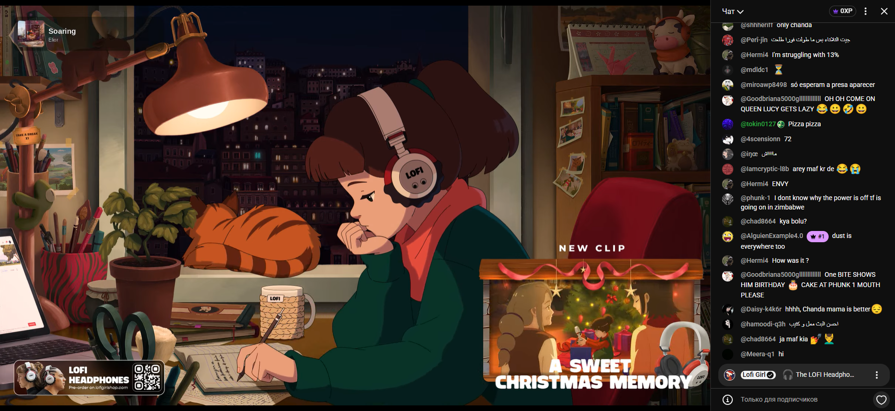

<p align="center">
  
</p>

# Outlndrr Extensions

A lightweight browser extension for **Helium and other Chromium-based browsers**. It combines profile-wide proxy settings, a better YouTube live-stream layout, unfiltered live chat, and control over page-visibility signals in one extension.

Built with Manifest V3, plain JavaScript, and CSS. **No build step, package installation, or runtime dependencies.**

> The extension interface is currently in Russian. This README uses English descriptions of its controls.

## Features

Each feature is independent and can be configured on the shared settings page.

| Feature | What it does | Default |
| --- | --- | --- |
| Browser proxy | Applies an HTTP or SOCKS5 proxy to the current browser profile, with optional HTTP authentication. | Off until configured |
| YouTube live theater | Places the live player on the left and native chat on the right, with video details below. | On |
| Always use Live chat | Selects Live chat instead of Top chat and hides the filtered option. | On |
| Disable Page Visibility | Overrides page visibility and focus signals exposed to websites. | On |

The toolbar popup shows proxy status, its server address and type, a copy-address button, and the number of enabled feature switches. A settings gear in the header opens the full settings page. The popup does not duplicate the switches or read saved proxy credentials.

The popup and settings use a Neko-inspired, dark-only design with sage accents, locally bundled Golos Text fonts, and the original cat photo as the extension icon. No UI assets are fetched from a CDN.

## Installation

Requires a Chromium-based browser with support for **Chromium 123 or newer**. This is a Chromium Manifest V3 extension, not a Firefox or Safari extension.

1. Clone this repository or download and extract its ZIP archive.
2. Open `chrome://extensions` in your browser. Some browsers redirect this to their own extensions page.
3. Enable **Developer mode**.
4. Click **Load unpacked** and select the repository folder containing `manifest.json`.
5. Refresh any open YouTube pages and other pages where you want the visibility feature to take effect.
6. Optionally pin the extension to the toolbar.

Open the toolbar popup and click the settings gear in the header to configure features. You can also open the extension's options from the extensions page.

After updating the source files, reload the extension on the extensions page and refresh affected tabs. No compilation is needed.

## Browser proxy

In settings, choose **HTTP** or **SOCKS5**, enter a host and port, and use **Save and enable**.

- Enter the host without a protocol, path, or port. IPv6 addresses must be enclosed in square brackets.
- One proxy is used for both HTTP and HTTPS websites in the current profile. Other profiles are not changed.
- Settings persist across closing the settings page and restarting the browser.
- A username and password are optional for HTTP proxies. A username with an empty password is supported.
- **Authenticated SOCKS5 is not supported by Chromium.** The extension rejects SOCKS5 credentials rather than silently ignoring them. Such servers require an external local adapter.
- **Disable** removes this extension's proxy override but keeps the saved form. The previous system, command-line, or extension configuration takes over; this does not necessarily mean a direct connection.
- Browser policies or another extension may prevent proxy control. The settings page reports the conflict.

### Browser proxy status

The popup reads the browser's effective proxy settings and displays `Статус прокси` beside a colored label: `Подключено` (connected) or `Отключено` (disconnected). An active proxy shows its protocol and a blurred host and port. The address stays blurred on hover, and tooltips do not reveal it. The copy button copies only `host:port`, with brackets around IPv6 addresses, and reports success or failure. Inactive, externally controlled, and unreadable settings show their explanation in the card. The status updates while the popup is open if proxy settings change.

Below the proxy card, `Включено функций` shows how many of the three feature switches are enabled: YouTube theater, full chat, and page visibility. Proxy status is shown separately. Unset switches use their enabled defaults; changes update the count immediately. Hover over the count to see the enabled features. If preferences cannot be read, the popup shows an unavailable count while keeping proxy status independent.

Opening the popup sends no diagnostic network requests and does not read saved proxy credentials. The status reports the browser's active configuration; it does not test server availability or authentication. Disabled, externally controlled, and unreadable settings have separate states.

### Security and limitations

- Proxy credentials are stored in `chrome.storage.local` **without encryption** and are not synced. Do not treat the browser profile as a secure credential vault.
- Credentials are supplied only to the configured HTTP proxy's matching authentication challenge, never to a website's authentication challenge. Repeated proxy authentication for the same request is cancelled to avoid endless retries.
- An HTTP proxy does not encrypt the connection to the proxy itself. With Basic authentication, an observer on that connection can read the credentials. HTTPS website content is still protected by the website's TLS connection.
- **This is not a VPN or an anonymity guarantee.** Localhost/link-local traffic, WebRTC/UDP, and some browser service traffic may bypass the proxy.
- An unreachable proxy can stop websites from loading. Open extension settings and disable it to recover.
- Incognito may inherit the regular profile's proxy. Allow the extension in incognito separately if you need automatic proxy authentication there, and test that setup explicitly.
- Browsers can cache HTTP authentication. Restart the browser if changed credentials are not taking effect.

## YouTube live theater

Open an **ongoing live stream** on `www.youtube.com` and enable YouTube's native **Theater mode** using the player button or `T` when focus is not in an input field.



- The player fills the available height below YouTube's header while preserving the video's aspect ratio.
- Native live chat occupies a 400-pixel column on the right and remains visible while scrolling.
- The title, channel, description, and other main-column content sit below the player; recommendations are hidden.
- YouTube's native hide/show chat controls still work. Hiding chat frees space for the video; unavailable chat leaves the video full-width.
- Regular videos, ended broadcasts, standard viewing mode, and fullscreen are left unchanged.
- Windows narrower than **960 CSS pixels** keep YouTube's native layout.

The extension does not replace the player, move the chat iframe, or switch viewing modes for you. Turning this feature off restores the native layout, and changes apply to open YouTube tabs without a reload.

Live status comes from the native player's data, including `isLiveNow` / `isLive`. Supported routes include `/watch?v=...`, `/live/...`, and channel live links such as `/@channel/live`.

## Always use Live chat

This switch is separate from the theater layout:

- Selects **Live chat** instead of **Top chat** and hides Top chat in the mode menu.
- Works in the normal page layout and YouTube's separate chat window.
- Handles late chat initialization and mode resets with a one-second recheck.
- Disabling it restores both menu options without forcing another selection.
- Does not modify chat replays on `live_chat_replay` pages.

The YouTube features do not read chat messages or send chat data anywhere. They depend on YouTube's DOM and player APIs, so site experiments, markup changes, or other player extensions may require compatibility updates.

## Disable Page Visibility

When enabled, a script runs in the page's MAIN world at `document_start` in matching frames, wherever the browser allows extension injection:

- `document.hidden` reports `false`, `document.visibilityState` reports `"visible"`, and `document.hasFocus()` reports `true`.
- The corresponding WebKit visibility properties are overridden too.
- Window/document `visibilitychange`, `blur`, and `focus` events are stopped before reaching page listeners. Input-element focus and blur events are left alone.

**Changes apply to new or reloaded pages**, not to scripts already injected into open tabs.

This does not stop background timer or `requestAnimationFrame` throttling. A site may still infer the real state through an untouched prototype in a fresh iframe or through input-element blur events. It can also affect sites that rely on normal visibility notifications. Browser-restricted pages are not covered.

## Permissions and data

| Permission | Why it is needed |
| --- | --- |
| `storage` | Stores local feature preferences and proxy settings; session storage tracks proxy authentication attempts. |
| `proxy` | Reads, applies, and clears the profile's proxy configuration. |
| `scripting` | Registers or unregisters the page-visibility script when its switch changes. |
| `webRequest` | Observes proxy authentication and request completion/failure to clean up retry tracking. |
| `webRequestAuthProvider` | Responds to HTTP proxy authentication challenges. |
| `<all_urls>` | Allows proxy authentication for requests to any site and visibility-script injection on supported pages. |

Feature preferences and proxy settings stay in the local browser profile rather than sync storage. The extension does not collect browsing history, record page contents, or include analytics. The popup reads proxy settings locally and sends no diagnostic network requests.

YouTube content scripts run only on `https://www.youtube.com/*`; the chat feature also runs inside live-chat frames. The visibility script is registered across supported sites only while its feature is enabled.

## Development

Use **Node.js 22 or newer**. There are no npm dependencies to install.

```sh
npm test
```

Tests use Node's built-in `node:test` and `node:assert/strict`. Run a single file while working on a feature:

```sh
node --test tests/proxy.test.cjs
```

The suite covers proxy validation and authentication, settings persistence and failures, popup status updates without network requests, copying proxy addresses, live feature counts and stale-result protection, YouTube state transitions, page-visibility overrides, and bundled UI assets. Browser APIs and page structures are mocked; passing tests do not replace checks against a real proxy or live YouTube page.

### Browser smoke checks

Load the repository as an unpacked extension, then check:

1. **Popup and settings:** open settings from the popup, toggle features, reopen the page, and verify persistence. Check keyboard navigation, narrow layouts, dark styling under a light OS theme, and reduced motion.
2. **Proxy:** test HTTP with and without authentication and SOCKS5 without authentication. Verify HTTP/HTTPS browsing and the external IP using a real server. SOCKS5 credentials must be rejected; website authentication must never receive proxy credentials.
3. **Proxy failures:** try a wrong password and an unreachable server. Check that retries stop and disabling restores the previous proxy configuration. The popup reports the active browser configuration even when the server is unreachable. Also check conflicting proxy control and persistence after restart; test incognito separately if used.
4. **Browser proxy status:** verify that opening the popup sends no diagnostic request in any state. Enable, change, and disable the proxy with the popup open; confirm the label, address, and type update, and conflicting proxy control is reported separately. Copy HTTP/SOCKS5 and IPv6 addresses, and check feedback when clipboard access is denied. Change feature switches and verify the enabled count updates independently of the proxy.
5. **YouTube theater:** use an ongoing stream, hide/show chat, toggle the feature, switch viewing modes, navigate between videos without reloading, and test a narrow window, a stream without chat, and both YouTube themes.
6. **Live chat:** check that only Live chat is offered while enabled, both choices return when disabled, a pop-out chat works, and chat replays stay unchanged.
7. **Disable Page Visibility:** inspect `document.hidden`, `document.visibilityState`, and visibility events while switching tabs. Disable the feature, reload the page, and confirm normal behavior returns.

### Repository layout

```text
manifest.json                Extension metadata, permissions, and script registration
background.js                Service worker entry point
features/
  proxy/                     Proxy configuration and HTTP authentication
  youtube-theater/           Player-state bridge and live-stream layout
  youtube-full-chat/         Live chat selection inside chat frames
  page-visibility/           Visibility overrides and dynamic registration
popup/                       Proxy status and shared UI styles
settings/                    Shared feature switches and proxy form
assets/                      Original cat photo, PNG icons, fonts, and asset licenses
tests/                       Dependency-free Node.js tests
AGENTS.md                    Repository and contribution guidelines
```

Keep independent features in their own `features/` directories, use plain JavaScript/CSS, and add focused tests for behavior changes. Avoid adding a build system or framework for a small feature. Never commit real proxy credentials, private keys, browser profiles, or local environment files.

## License and credits

A project-wide license for the extension's source code has not been selected. Bundled third-party assets retain their own licenses:

- **Golos Text:** [SIL Open Font License 1.1](assets/fonts/OFL.txt).
- **Lucide arrow icon:** [Lucide license and included notices](assets/LUCIDE-LICENSE.txt).
- **Cat photograph:** a user-provided asset; the font and icon licenses above do not cover it.

The popup and settings styling is inspired by the Neko design system.
